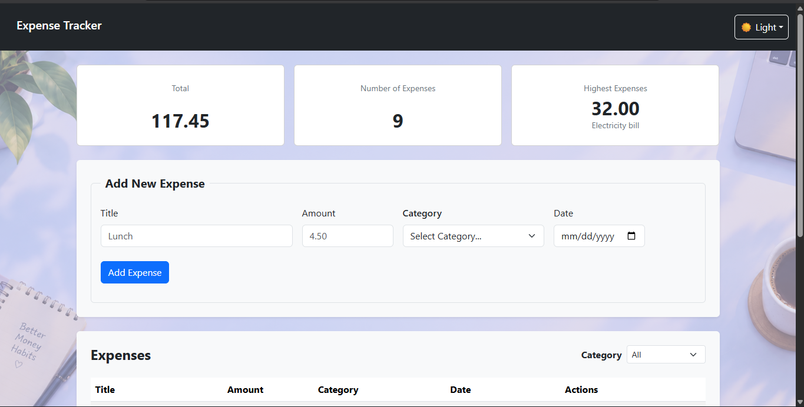
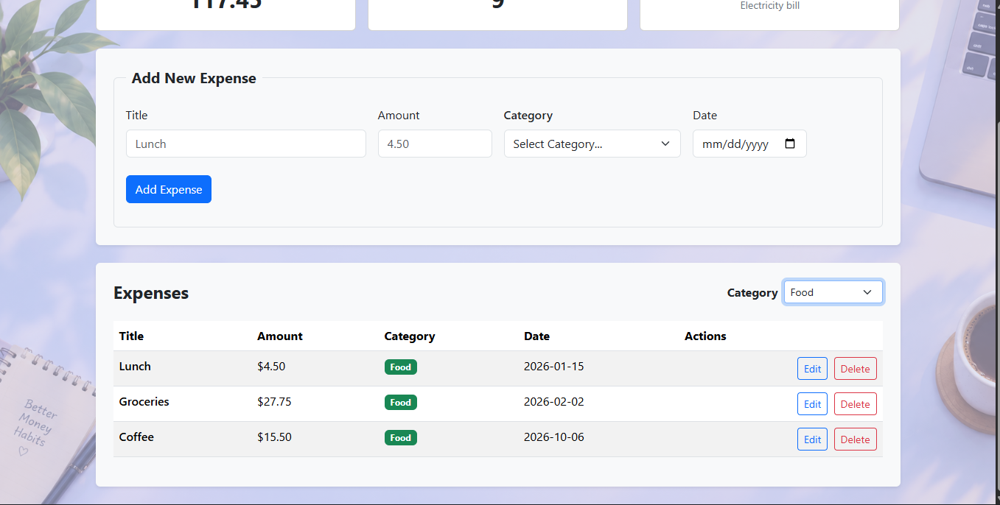
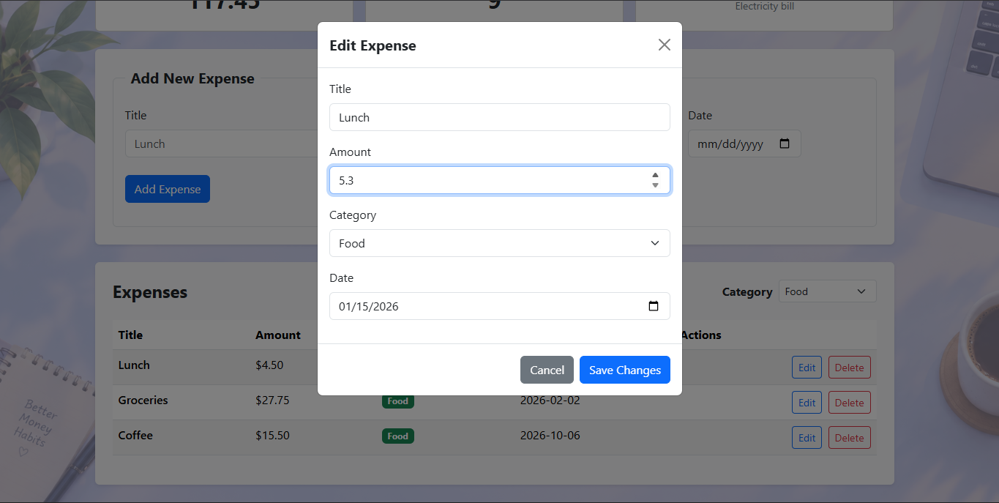

# Expense Tracker

<!-- Write 1-2 sentences: what does your app do? -->
An intuitive personal expense tracking system that logs your spending with its title, amount, date, and category. It provides real-time financial insights, including your total expenditure, total number of logged expenses, and the highest amount spent alongside its specific details.

## How to run

<!-- Write the exact steps someone needs to run your project from scratch.
     Assume they have Node.js, PostgreSQL, and VS Code, and nothing else.
     Include: creating the database, running schema.sql, writing the .env file,
     starting the backend, and opening the frontend. -->

1. Database Setup (PostgreSQL)

Open pgAdmin, create a new database, and name it as desired (e.g., expense_tracker).

Select your new database and open the Query Tool.

Copy and paste the contents of the schema.sql file provided in the project, then execute it to set up the database tables.

**Backend**

Ensure Node.js is installed on your system.

Open the terminal in the backend directory and install Express.js along with required packages using:
npm install

The server.js file sets up the server and REST APIs to handle communication between the frontend and PostgreSQL.

Start the backend server using:
npm server.js

**Frontend**

Design (UI): Built with Bootstrap 5 via CDN integration in index.html, utilizing customized components to reach the desired web layout.

Logic & Interactivity: Handled via app.js to connect the UI with the API endpoints, enabling dynamic features such as automatic data loading on start, real-time filtering, and live financial summary calculations.

Execution: Launch index.html using Live Server in VS Code (or open it directly in your web browser).

## Features

<!-- List what your app can do. Tick what you finished. -->

- [/] Add an expense (with validation)
- [/] Delete an expense
- [/] Edit an expense
- [/] Filter by category
- [/] Summary cards (total, count, highest)
- [/] Data is saved in a PostgreSQL database

## Screenshots

<!-- Add 2-3 screenshots of your app (desktop and mobile). -->

## What was the hardest part?
<!-- A short paragraph: what got you stuck, and how did you solve it? -->

Working with APIs was the most challenging part since it was a completely new topic for me. At first, I didn't know where to start, but I managed to overcome this by reading documentation, watching YouTube tutorials, and searching through various online resources until I got the hang of it.

## GitHub Repository
[View Project on GitHub](https://github.com/ZumurudaNasayreh/expenceTracker.git)